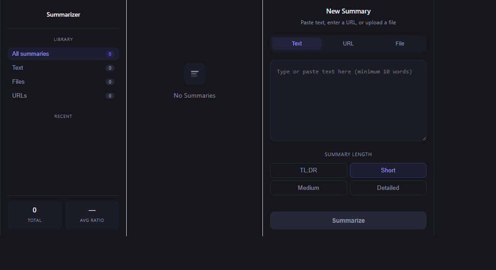
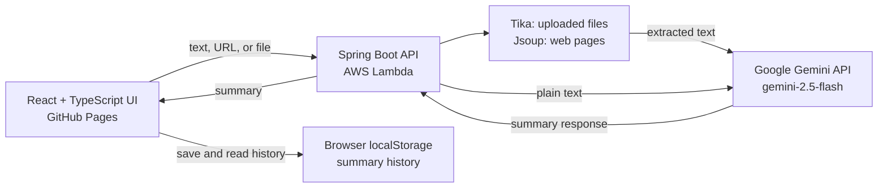
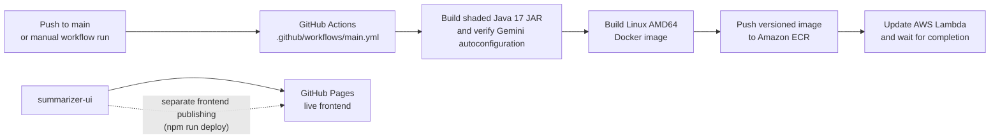

# Basic Summarizer

## Serverless document summarizer: text, PDF, and URL input, powered by Gemini on AWS Lambda

Summarize pasted text, web pages, and uploaded documents with Google Gemini. The React app keeps a filterable history in the current browser, while a Spring Boot API extracts content and requests a summary from Gemini.

**Live app:** [noahsmith13579.github.io/basicSummarizer](https://noahsmith13579.github.io/basicSummarizer/)



## What it does

- Summarizes text, article URLs, and PDF, TXT, DOC, or DOCX files.
- Offers TL;DR, short, medium, and detailed summary lengths.
- Shows word counts and compression ratio, and lets you filter and remove saved summaries.
- Extracts document text with Apache Tika and article text with Jsoup.
- Uses Gemini 2.5 Flash for generation.

## Architecture



The browser sends summarization requests to the API. Files and URLs are extracted on the backend; plain text is sent directly to Gemini. The returned summary is saved in browser `localStorage`, not in a server-side database.

## CI/CD and hosting



The checked-in GitHub Actions workflow deploys the **backend** when `main` is updated (or when manually triggered). The frontend is hosted separately on GitHub Pages; `summarizer-ui` provides an `npm run deploy` script that publishes the built `dist` directory. Frontend publishing is not part of the Lambda workflow.

## Design decisions

- **Separate UI and API:** React components use repository/service adapters so API summarization and browser-only history are distinct responsibilities.
- **No history database:** summaries persist in `localStorage`, keeping deployment simple and history local to each browser.
- **Backend extraction:** Tika handles uploaded document formats and Jsoup extracts article-like content from URLs before prompting the model.
- **Bounded summary choices:** four named lengths map to prompt instructions instead of exposing arbitrary prompt controls.
- **Large-file handling:** file text over 3,000 words is summarized in chunks, then those chunk summaries are combined into the requested final length.

## Run locally

Prerequisites: Java 17, Node.js/npm, internet access, and a Google AI API key.

Start the backend from the repository root:

```powershell
$env:GOOGLE_API_KEY = "<your Google AI API key>"
.\gradlew.bat bootRun
```

The API listens on `http://localhost:8080`.

In another terminal, start the UI:

```powershell
Set-Location .\summarizer-ui
npm install
$env:VITE_API_URL = "http://localhost:8080/"
npm run dev
```

Open the local URL printed by Vite. `VITE_API_URL` is the API base URL; the client appends `api/v1/`. For production, configure the UI's API base URL at build time and set `GOOGLE_API_KEY` in the backend environment. Do not commit API keys.

## Limitations

- Summary history is browser-local. It does not sync across browsers/devices and clearing site data removes it.
- The API does not persist summaries or provide account-based history
- URL extraction fetches server-visible HTML and does not run page JavaScript. Paywalls, bot protections, and unusual page layouts can prevent useful extraction.
- The backend accepts uploads up to 50 MB. Files larger than 3,000 extracted words can require multiple Gemini requests, increasing latency and API usage.
- Results depend on Gemini availability, quotas, and output quality. Summaries can omit details or make mistakes; verify important information.
- The GitHub Actions workflow deploys only the backend. Frontend publishing and its API endpoint configuration are separate.

## Checks

```powershell
.\gradlew.bat test
Set-Location .\summarizer-ui
npm run build
npm run lint
```
